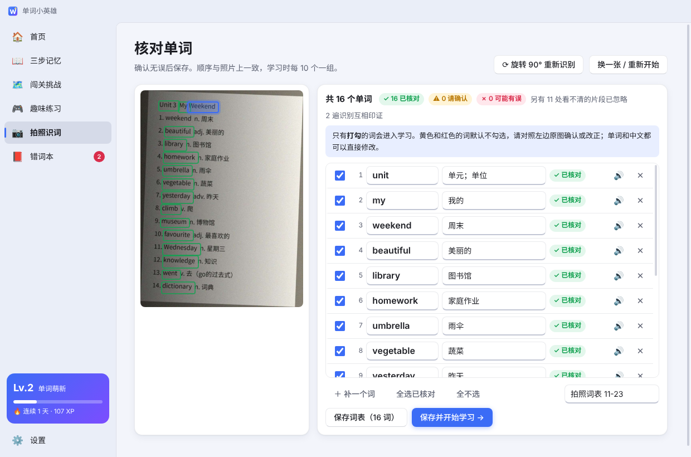

# 单词小英雄 WordHero

给小学到初中学生用的英语单词记忆软件（Windows 11 桌面版，支持 ARM64 和 x64）。
每次只背 10 个词：**先看一遍 → 用给定字母拼 → 自己默写**。


## 下载安装

到 [Releases](https://github.com/Rowan-Achterberg/word-hero/releases/latest) 下载安装包：

| 电脑 | 安装包 |
| --- | --- |
| Windows 11 ARM64（骁龙等 ARM 处理器） | `WordHero-Setup-x.y.z-arm64.exe` |
| Intel / AMD 处理器 | `WordHero-Setup-x.y.z-x64.exe` |

双击安装，桌面和开始菜单会出现「单词小英雄」。安装包没有代码签名，首次运行若出现 SmartScreen 提示，点「更多信息 → 仍要运行」。

## 三步记忆（核心学习流程）

词表里的单词**按原顺序每 10 个一组**，每组走三步：

1. **看一遍**：同时显示单词、音标和中文意思，并自动朗读（可设 1～3 遍，可开自动播放）。看完有全组回顾。
2. **字母拼词**：只给中文意思和这个词的全部字母（顺序打乱），把字母排成正确的单词。每次一个词，可点击也可直接敲键盘。
3. **默写**：只给中文意思，自己把单词写出来。每次一个词。写错会显示正确拼写并要求照着写一遍。

第 2、3 步里写错的词会排到本步最后再考，直到写对。默写没有一次写对的词进入「错词本」，
并按 1 / 2 / 4 / 7 / 15 天的间隔安排复习。


## 其它学习模式

- **闯关挑战**：每组 10 个词是一关，3 颗爱心，题型逐步变难（选择 → 听音 → 拼词 → 默写），每 5 关一个 Boss 关，混合前 50 个词。
- **趣味练习**：听音拼写、60 秒闪电四选一、英汉配对消消乐。
- **错词本 / 今日复习**：自动收集、到期提醒。
- 经验值、等级、连续学习天数、星级评价。


## 词库

| 词书 | 词数 | 说明 |
| --- | --- | --- |
| 小学核心词汇 | 532 | 按主题编排（问候、数字、颜色、动物、食物…），中文释义人工校对 |
| 初中中考词汇 | 1080 | 由常用到少用，中文释义人工校对 |
| 高中拓展词汇 | 2117 | 学有余力再挑战，释义来自 ECDICT |

另有约 3 万词的离线词典（含 2.6 万个变形，如复数、过去式），用来核对拍照识别和手动输入的单词。

## 拍照识词

把课本、试卷或老师发的单词表拍下来（选择图片 / 拖入 / Ctrl+V 粘贴 / 摄像头），软件抓出英文单词，
保持照片上的顺序，保存成自己的词表来学。也可以手动输入或粘贴单词。



识别不可能 100% 准确，所以设计目标是**认错的词进不了学习**：

1. 先做去阴影、提高对比度处理；文字过小或过大时自动缩放后重新识别。
2. 同一张照片识别多遍并互相印证：Tesseract（最佳精度模型）识别灰度图和黑白图各一遍，
   在 Windows 上再用系统自带的 Windows OCR 复核一遍。
3. 每个词都和离线词典核对。词典里没有的词标红、给出改正建议、默认不勾选；把握不大的词标黄、默认不勾选。
4. 原图和识别结果并排显示，只有打勾的词会保存；单词和释义都可以修改，改动会重新查词典。
5. 中文释义来自内置词典，不从照片里认中文。

仍需人工看一眼的情况：照片把一个词认成了另一个真实存在的词（比如 `form` / `from`）。这种情况词典查不出来，
多遍识别不一致时会标黄提醒，但请保存前对照原图扫一遍。手写体识别不可靠，建议用手动输入。

## 发音

默认使用有道词典的真人发音（需要联网，听过的词会缓存到本机），没网时自动改用 Windows 自带语音。
可在设置里选美式 / 英式，或只用系统语音。

## 数据

学习进度、词表和设置保存在本机 `%APPDATA%\WordHero\wordhero-data.json`，不上传。

## 开发

```bash
npm install
npm start          # 运行
npm test           # 词典、词库、图像预处理的逻辑测试
npm run dist       # 在 Windows 上生成 ARM64 和 x64 安装包（dist/ 目录）
```

每次推送到 `main`，GitHub Actions 会在 Windows 上构建两个安装包，并发布到与 `package.json` 版本号对应的 Release（发新版时先改版本号）。

重新生成词库：下载 [ECDICT](https://github.com/skywind3000/ECDICT) 的 `ecdict.csv` 放到项目根目录，运行 `npm run dict`。
小学、初中词书的单词和释义在 `tools/primary.txt`、`tools/junior.txt` 里，可以直接修改。

## 致谢

- [ECDICT](https://github.com/skywind3000/ECDICT)（MIT）：词典数据与音标
- [Tesseract](https://github.com/tesseract-ocr/tesseract) / [tesseract.js](https://github.com/naptha/tesseract.js)（Apache-2.0）：离线文字识别
- [Electron](https://www.electronjs.org/)

代码以 MIT 许可发布。
